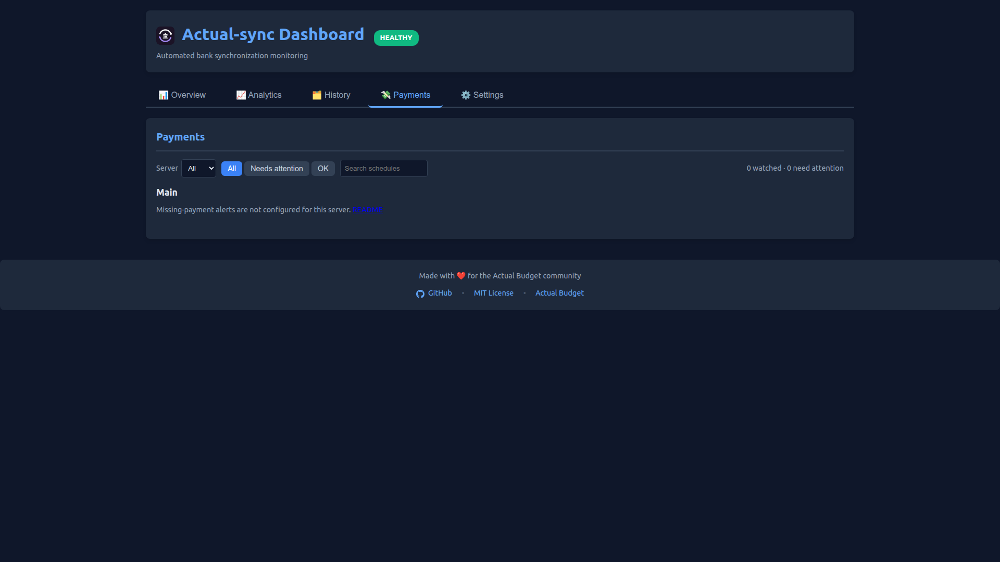
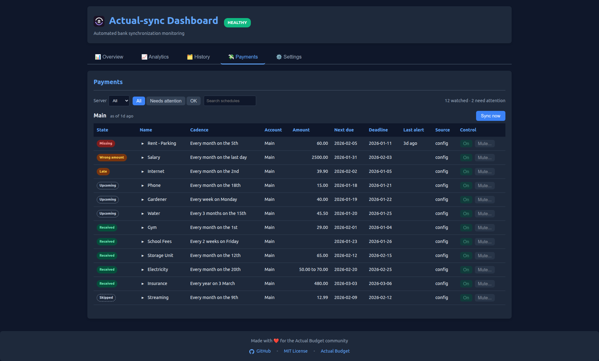
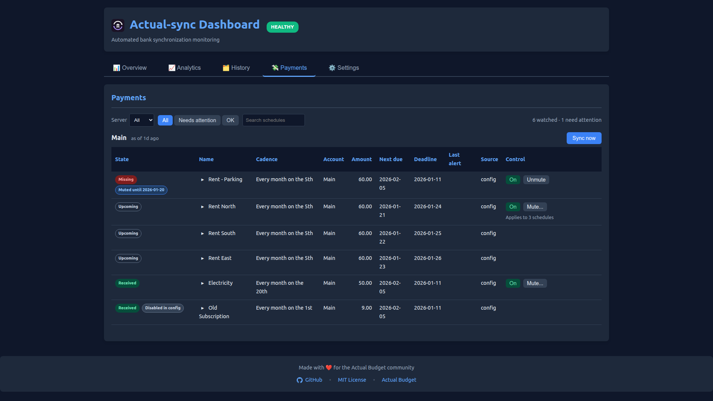
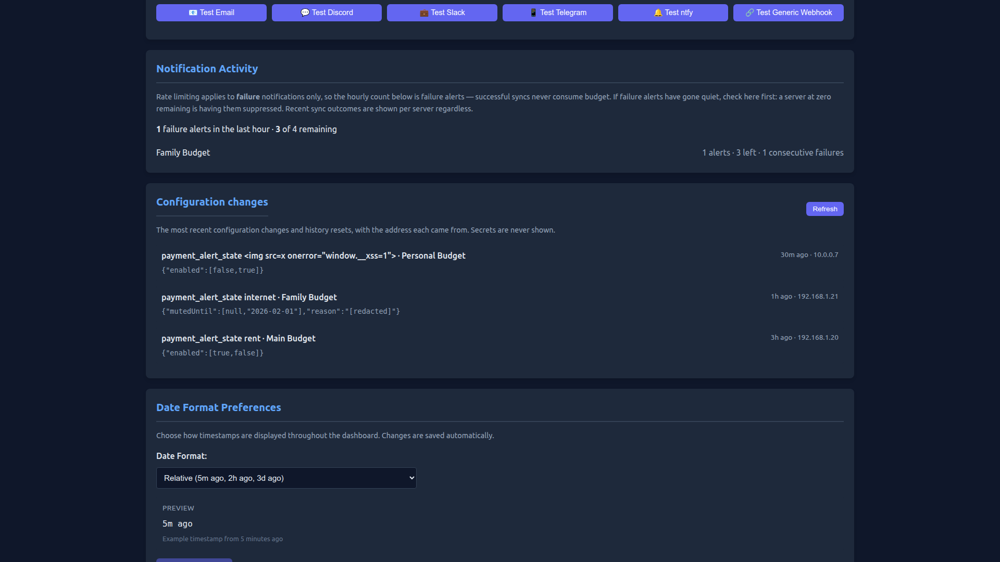

# Web Dashboard

The Actual-sync web dashboard provides comprehensive real-time monitoring, manual sync controls, interactive analytics, and system management through a modern tabbed interface.

## Overview

The dashboard is a responsive single-page application that offers:

- **📊 Overview Tab** - 2-column layout with service health, server status, per-account syncability (syncable / manual / closed badges, with a "Show closed" toggle), recent activity, and live logs
- **�� Analytics Tab** - All-time statistics with interactive charts (success rates, duration trends, timeline)
- **🗂️ History Tab** - Searchable sync history with server/limit filters, a per-sync account breakdown (`N synced · M failed · K skipped`), and detailed error messages
- **⚙️ Settings Tab** - Date format preferences, orphaned server cleanup, and data management
- **🔴 Live Status** - Real-time WebSocket streaming with ring buffer (500 logs, 200 displayed)
- **🔐 Authentication** - Optional basic auth or token-based authentication
- **🎨 Dark Theme** - Modern UI optimized for long monitoring sessions

## Content-Security-Policy and customising the page

Every response carries a strict Content-Security-Policy (details and the full header list in [SECURITY_AND_PRIVACY.md](SECURITY_AND_PRIVACY.md#http-security-headers-243)). The rules that matter if you edit the dashboard:

- **No inline `<script>` and no inline event attributes** (`onclick="..."`, `onchange="..."`, `onerror="..."`). The browser silently refuses them. The page's code lives in `src/services/dashboard.js`, served at `/dashboard.js`. Wire a button with `data-action="name"` (and optional `data-arg="value"`) plus an entry in `CLICK_ACTIONS`, or `data-change="name"` plus an entry in `CHANGE_ACTIONS`; one delegated listener handles buttons added later by `innerHTML`.
- Scripts may only come from this origin. Do not add a `<script src="https://...">`.
- Inline `style="..."` attributes are allowed (`style-src 'unsafe-inline'`), because the page uses many of them.
- Network calls may only go to this origin (`connect-src 'self'`), which includes the `/ws/logs` WebSocket.
- The page cannot be shown inside an iframe (`frame-ancestors 'none'` and `X-Frame-Options: DENY`), which blocks clickjacking. A Home Assistant `panel_iframe` or a Homarr or Organizr iframe tile shows an empty frame; link to the dashboard so it opens in its own tab instead.
- If the page is blank or a button does nothing after an edit, open the browser console: a blocked resource is reported as `Refused to ...`. The e2e suite (`tests/e2e/csp.e2e.js`) fails on any violation.

## No external network dependencies

The dashboard loads nothing from the internet. Chart.js is a regular npm dependency of the service and is served from the app itself at `/vendor/chart.umd.min.js`, the same way the logo is served at `/icon.png`. The page therefore renders fully, charts included, on an air-gapped host or with all outbound traffic blocked, and no third party is contacted when you open it.

## Live Logs authentication

The Live Logs panel streams from `/ws/logs`, which is authenticated like the rest of the dashboard. Before each connect the page fetches a single-use, 30 second ticket from `/api/dashboard/ws-ticket` using the same credentials as every other dashboard request, then opens the stream with it. You do not configure anything for this.

If the panel keeps showing "Disconnected from log stream. Reconnecting...", look at the service log and the browser's network tab:

- **No `WebSocket handshake refused` line, and a failing `/api/dashboard/ws-ticket` request** (401, 429 or 5xx): the ticket request never reached the handshake, so nothing is logged for it. Look for `Dashboard authentication failed` or `Dashboard authentication throttled` instead, then reload the page and sign in again.
- **`WebSocket handshake refused`, status 401**: the ticket was missing, already used or older than 30 seconds. A ticket is spent by any handshake attempt, including a refused one, so a retry always asks for a new one.
- **status 403, Origin not allowed**: the `Origin` header does not match the `Host` header the service received. The usual cause is a reverse proxy that rewrites `Host`: nginx `proxy_set_header Host $host;` drops a non-default port (the browser says `example.com:8443`, the service sees `example.com`). Use `proxy_set_header Host $http_host;` so the original Host is passed through. Only if the page really is served from a different origin than the one the browser connects to, add that origin to `dashboard.allowedOrigins` (see [CONFIG.md](CONFIG.md)).
- **status 429**: more than 10 log streams are open from one address (every browser tab holds one). Behind a reverse proxy, set `healthCheck.trustProxy` so the count is per real client instead of per proxy.
- **A button returns 403 `origin_rejected`** (Sync now, Dismiss, Reset history, Test notification): the browser sent an `Origin` (or `Referer`) that does not match the `Host` the service received, and it is not in `dashboard.allowedOrigins`. The cause and the fix are the same as for the status 403 item above: pass the original Host through the proxy (`proxy_set_header Host $http_host;`) or add the page origin to `dashboard.allowedOrigins`. Requests without browser headers (curl, Home Assistant) are not affected.

## DNS rebinding with `auth.type: none`

The Origin check compares `Origin` with `Host`. A DNS rebinding attack makes both name the attacker's domain while it resolves to your service, so the check passes. With `dashboard.auth.type: none` that exposes the live log stream, every dashboard page and the four state-changing POSTs (`sync`, `dismiss-error`, `reset-history`, `test-notification`) to a web page open in a browser on the same network. There is no Host allowlist (it would need a new setting, and the maintainer has not chosen one). If the dashboard is reachable from browsers that visit untrusted sites, do not leave auth at `none`: use `basic` or `token`, which a rebinding page cannot supply, or bind to `127.0.0.1` behind a proxy that only forwards your own host name.

## Locked out after failed logins

After 10 wrong usernames, passwords or tokens from one address within 15 minutes, the dashboard answers `429 Too many failed authentication attempts` for the rest of the window, even once the right credentials are entered. Wait 15 minutes, or restart the service to clear it. If it keeps coming back after you change the password or token, an old browser tab or a script still polls with the old credential: close every other dashboard tab and update those scripts, or the lockout returns every window. The service log shows `Dashboard authentication throttled after repeated failures` with the address. Behind a reverse proxy, set `healthCheck.trustProxy` so one client's mistakes do not lock out everyone behind the same proxy. The limits are fixed and have no config key.

## Account syncability

The Overview tab lists each server's accounts with a badge so you can tell, at a glance, which accounts actually bank-sync:

- 🟢 **syncable** — bank-linked (`account_sync_source` set) and open; these are the accounts that bank-sync.
- ⚪ **manual** — open but not bank-linked; runs no bank sync.
- 🔴 **closed** — a closed account; hidden by default, revealed with the **Show closed** toggle.

The data is captured during each sync (the same partition the engine uses to decide what to sync, see [ARCHITECTURE.md](ARCHITECTURE.md)) and persisted to SQLite, so the dashboard renders it **without opening a live connection to the Actual server**. It is therefore as fresh as the last sync; a server that has never synced this session shows no accounts yet.

Served at `GET /api/dashboard/accounts` (subject to the dashboard's auth setting), grouped by server.

## Payments tab

The **Payments** tab shows what the [missing-payment alerts](SCHEDULE_ALERTS.md) concluded for every watched schedule. The states are always the real evaluation result; the [controls](#turning-alerts-off-and-muting) change only whether notifications are sent. Like the account list, the tab renders **without a connection to Actual**: it reads the snapshot each sync saves, through `GET /api/dashboard/payments`. It is therefore as fresh as the last sync, and the "as of" line says when that was.

**Columns.** State, Name, Cadence (Actual's own wording), Account, expected Amount, Next due, Deadline, Last alert (the last alert actually sent), Source and Control (see below). The button before a name opens the last 6 occurrences, each with its state, received date and amount, and "(+3d)" for a late one. Below 768 px rows become cards and Account, Last alert and Source move into that expanded view.

**States.** The pill text is always shown, so colour is never the only signal.

| State | Pill | Needs attention |
|---|---|---|
| `upcoming` | outline | no |
| `received` | green | no |
| `late` | amber | no |
| `missing` | red | yes |
| `wrongAmount` | amber | yes |
| `cannotCheck` | grey | yes |
| `skipped` | grey, dashed outline | no |

Rows are sorted attention first, then late, upcoming, received, skipped; within a group by deadline (none last), then name. The state buttons filter to **Needs attention** or **OK** (everything else, including skipped), and the search box matches name, payee, account and cadence. "N watched · M need attention" counts every schedule of the servers shown, whatever the filters.

**Amounts and dates.** Amounts are plain decimals with no currency symbol (`60.00`, a range as `50.00 to 70.00`), as in the notifications. Next due, Deadline and occurrence dates are calendar dates: they are never shifted by your time zone and never shown as "Just now", and they follow the date format chosen in Settings (the `relative` format shows `YYYY-MM-DD` for them). Last alert and the "as of" and failure times are instants and follow the Settings format like the rest of the dashboard.

**Several servers.** With "All" selected the rows are grouped per server, each group with its own heading, "as of" line and failure line. Every server with alerts configured has one **Sync now** button in its heading, which syncs that server only; a server without `scheduleAlerts` shows a note linking to the README instead. The server select shows a single group.

**Refresh and Sync now.** The tab refreshes every 60 seconds while it is the active tab and the page is visible, and at once when you open it or return to the page. After **Sync now** it watches `/api/dashboard/status` and refreshes once no sync has been running on two consecutive reads (it gives up after 120 seconds). If starting the sync fails, the group heading says "Could not start sync (HTTP 429)" or "(network error)" and the next click retries.

**When something is wrong.**
- *No successful evaluation yet*: the very first run failed, so there are no rows, only this line and the failure line.
- *last evaluation failed at ... (error code)*: the latest run failed; the rows of the last good run stay, and "as of" is that run's time. When some rules could not be evaluated, the line also says how many and that their last values are shown.
- *Runs after the next sync*: alerts are configured but no run has happened yet.
- *Could not refresh payments (HTTP 503)* or *(network error)*, in a red banner above the table: any failed refresh keeps the last good rows and the next good refresh clears the banner.

### Turning alerts off and muting

The last column, **Control**, switches an alert off or on and mutes it until a date. Changes apply from the next sync, with no restart, and are stored in the sync-history database (the configuration file is never rewritten). They need `healthCheck.dashboard.allowConfigWrites: true` and dashboard auth other than `none`; see [CONFIG.md](CONFIG.md).

- **The switch** (On or Off, a real switch for assistive technology) turns the alert's notifications off or on. Switching off sends nothing and writes no record; switching on delivers what is still open at the next sync.
- **Mute...** opens a form under the row: pick the date the mute ends and give a **reason** (required, up to 200 characters), then Mute (Enter saves, Esc cancels). The alert is still evaluated while muted and the tab keeps showing the real state; nothing is sent until the end of that day, and then **one summary message** per destination lists what happened during the mute. **Unmute** ends a mute early and sends no summary.
- **The badge** beside the state pill, never in place of it, reads "Muted until <date>" (the reason is in its tooltip), "Mute ended, summary pending" until the summary has gone out, or "Disabled in config" for an alert with `enabled: false` in `config.json`. A config-disabled alert has no switch and cannot be muted or switched on here; only an old mute can still be cleared.
- **A rule that matches several schedules** (`schedulePrefix`) has one switch and one mute for the whole rule. They sit on the first visible row of that rule, with "Applies to N schedules"; the other rows show only the badge.
- **Read-only dashboards.** When changes are not allowed the controls are shown but disabled, with a tooltip naming the setting to change ("Changes from the dashboard are off. Set healthCheck.dashboard.allowConfigWrites to true." or "Changes from the dashboard need dashboard authentication (basic or token).").
- **Errors** (a refused or failed request) put the switch back to its stored state and are announced in a message above the table, which a refresh does not erase. An open mute form keeps what you typed through filters, search and refreshes, and closes if its alert leaves the snapshot.

The Settings tab has an **Orphaned alert overrides** card listing overrides whose alert or server is no longer in the configuration (for example after renaming an alert id), each with a Delete button. They have no effect on delivery; delete them to clear the stored reason.

### Managing alerts from the dashboard

Besides `config.json`, alerts can be created, edited and deleted here (#268). They are stored in the sync-history database like the switch and the mute, validated by the same validator as `config.json`, and apply from the next sync. The API behind the dialog is in [HEALTH_CHECK.md](HEALTH_CHECK.md#payment-rules-262); the rules' semantics are in [SCHEDULE_ALERTS.md](SCHEDULE_ALERTS.md#rules-from-the-dashboard).

**Buttons.** Each server group has **Add alert**. Each row has these in the Control column:

| Row | Buttons |
|---|---|
| Dashboard rule | Edit, Delete, Copy as JSON |
| Rule from `config.json` | View (read-only), Copy as JSON |
| Dashboard rule replaced by a config rule with the same id ("Replaced by config.json") | Delete |
| Rule on a server whose `scheduleAlerts` block was removed ("Dormant: no scheduleAlerts block") | View, Delete, Copy as JSON |
| Stored rule that no longer validates ("Invalid, not evaluated") | Delete |

A rule that has not been evaluated yet (just saved, or added since the last sync) shows "Not evaluated yet". A rule saved after the last evaluation shows "Edited, applies from the next sync".

**The dialog.**
- **Id.** Filled in from the schedule name (`rent-parking-a`); a taken id gets `-2`, `-3`. Two schedules with the same name are told apart in the picker by the last 6 characters of their id. Fixed after the first save. Completed schedules are not offered.
- **Watch.** One schedule, or every schedule whose name starts with a prefix (case-sensitive, with the number of matches shown; 0 means the rule will report `ruleUnmatched`). The line under the picker shows the schedule's cadence, amount, account and payee, and when the list was captured.
- **Deadline.** Grace days and early days. For a monthly schedule whose day plus grace stays within 28, the line reads "deadline: 11th of each month"; otherwise it shows the real date for the next payment, since month length decides where it lands.
- **Month shown in `{{period}}`**, **tolerance** (the placeholder says what the schedule itself implies), **reminders** and **channels** (the configured ones; at least one stays ticked, and all ticked means "use every channel", which writes nothing).
- **Messages.** One text per event, prefilled with the server's own template or the built-in one; an emptied box goes back to the default. Variable chips insert at the cursor.
- **Preview.** Renders the selected event as you type (after a short pause), with sample values for what only a real occurrence has, and says which. **Send test to all destinations** delivers it to every configured channel and lists the result per destination; it records no alert history (5 per minute).
- **Save** with Enter or the button. Fields the server rejects are marked beside the field; anything else is a banner at the top. **Delete** asks first ("Delete this alert?" with Keep).
- **Copy as JSON** copies the rule as a complete `alerts[]` entry to paste into `config.json`. When the browser blocks the clipboard (plain HTTP on a non-localhost address), the dialog shows the JSON in a box with "Press Ctrl+C to copy".

**States.**
- **No schedule snapshot yet** (no sync has finished on the server): the Watch section says so and offers Sync now. Nothing can be saved until a schedule is picked or a prefix typed.
- **Server not configured** (no `scheduleAlerts` block): Add alert is disabled with a tooltip. Add `"scheduleAlerts": { "alerts": [] }` to the server in `config.json` first.
- **Writes off** (`allowConfigWrites` false or auth `none`): Add, Edit and Delete are disabled with the usual tooltip; View and Copy as JSON still work. If writes turn off while a dialog is open, Save reports it and stays disabled.
- **Alert list unavailable**: the rule list failed to load. The snapshot rows still show, Add alert is disabled and the group says "Alert list unavailable"; it recovers at the next refresh.
- **Small screens.** Under 600 px wide the dialog fills the screen.
- **Keyboard.** Esc closes the dialog without saving, and focus returns to the button that opened it. The dialog's own messages are announced as alerts.

**Errors.** Wording is the dashboard's; the code is what the API sent.

| Code or status | Shown as |
|---|---|
| `invalid_rule` | beside the field named in `details[].path`; if a path names no field, in the banner |
| `invalid_template` | under that message's box: the unknown variable or helper, a syntax error with its line, or a Telegram markup problem |
| `duplicate_id` | on the id: "An alert with this id exists" |
| `id_in_config` | on the id: "config.json already has an alert with this id" |
| `rule_not_found` | "This alert no longer exists."; the dialog closes and the list reloads |
| `config_writes_disabled` (403) | "Configuration changes are turned off (...)"; the controls disable |
| `managed_in_config` | "This alert is managed in config.json. Copy as JSON to change it there." |
| `alerts_not_configured` | "Add a scheduleAlerts block to this server in config.json first." |
| `too_many_rules` | "Limit of 200 dashboard alerts reached. Delete one first." |
| `no_configured_destination` (preview) | "No notification channel is configured for this rule." |
| `test_send_rate_limited` (429) | "Too many test messages, wait a minute." |
| `send_failed`, `send_threw`, `timeout`, `channel_unavailable` (preview) | a note under the preview, with the per-destination results when there are any |
| 401 | "Your session has expired or the credentials are wrong. Reload and sign in again." |
| 413 | "This alert is too large to save (16 KB limit)." |
| 500 | "The server could not save this alert. Try again; see the service log." |
| 503 | "Sync history is not available, so alerts cannot be edited." |
| no response | "Could not reach the server. Check your connection and try again." |

Schedule names, rule fields and server messages are shown as text, never as HTML.

Enable dashboard auth when `scheduleAlerts` is used: with the default `auth.type: none` this tab and its data are open to anyone who can reach the port.

## Behind a reverse proxy

If nginx, Traefik or Caddy sits in front of the dashboard, set `healthCheck.trustProxy` (usually `1`, one proxy) so the per-client rate limit and the auth-failure log see the real client IP instead of the proxy's. Keep `dashboard.auth` enabled, and do not also publish the port directly. See [CONFIG.md](CONFIG.md#healthcheck-optional) for the accepted values and [DOCKER_DEPLOYMENT.md](DOCKER_DEPLOYMENT.md#1-security) for an nginx example, including the `/ws/logs` location.

## Configuration changes

The Settings tab lists the most recent configuration changes (newest first): when, which server, the action, the target, the client address and the changed fields. Secrets (passwords, tokens, API keys, webhook URLs, URLs with credentials) are shown as `[redacted]`. A history reset keeps this list and adds one `history_reset` entry. Entries are purged with the sync history after `retentionDays`. The same data is available at `GET /api/dashboard/config-audit?limit=N` (1 to 200, default 50).

The dashboard never changes configuration unless `dashboard.allowConfigWrites` is `true` and auth is not `none`; see [CONFIG.md](CONFIG.md).

